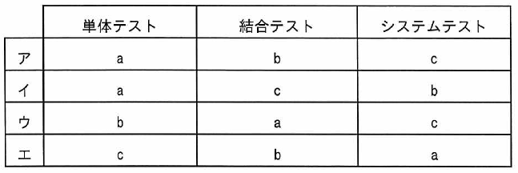

ITパスポート試験
## 令和5年度 問42 (マネジメント系)

ソフトウェア開発における、テストに関する記述a～cとテスト工程の適切な組合せはどれか。

<ol type="a">
  <li>運用予定時間内に処理が終了することを確認する。</li>
  <li>ソフトウェア間のインタフェースを確認する。</li>
  <li>情報システム戦略を実現するために、必要な責任と要員を組織に割り当てる。</li>
  <li>プログラムの内部パスを網羅的に確認する。</li>
</ol>

***

テストとは、ソフトウェア開発で実装後にシステムが仕様どおりに動作するかを確認する工程である。テスト内容やチェック項目に関しては、要件定義プロセスで決めておく。

<ol type="a">
  <li class="ans"><i>運用予定時間内に処理が終了することを確認する。</i>システムテスト</li>
  <li class="ans"><i>ソフトウェア間のインタフェースを確認する。</i>結合テスト</li>
  <li class="ans"><i>プログラムの内部パスを網羅的に確認する。</i>単体テスト</li>
</ol>

システム開発のライフサイクル

<table border="1">
<tr><td rowspan="2">システム要件定義</td><td>機能要件</td></tr>
<tr>                                    <td>非機能要件</td></tr>
<tr><td>ソフトウェア要件定義</td><td>共同レビュー</td></tr>
<tr><td>システム方式設計</td><td> </td></tr>
<tr><td rowspan="2">ソフトウェア方式設計</td><td>機能設計</td></tr>
<tr>                                        <td>詳細設計</td></tr>
<tr><td>プログラミング（コーディング）</td><td></td></tr>
<tr><td rowspan="3">単体テスト</td><td>コードレビュー</td></tr>
<tr>                                <td>ホワイトボックステスト</td></tr>
<tr>                                <td>デバッグ</td></tr>
<tr><td rowspan="3">結合テスト</td><td>ブラックボックステスト</td></tr>
<tr>                                <td>同値分割</td></tr>
<tr>                                <td>境界値分析（限界値分析）</td></tr>
<tr><td rowspan="3">システムテスト</td><td>性能テスト</td></tr>
<tr>                                <td>負荷テスト</td></tr>
<tr>                                <td>回帰テスト（リグレッションテスト）</td></tr>
<tr><td>運用テスト</td><td>受け入れテスト（妥当性確認テスト）</td></tr>
</table>

p.238

[ H20f, H21f, H22s, H22f, H23f, H23, H24f, H25s, H25f, H26f, H28s, R4, R5, R8 ]
