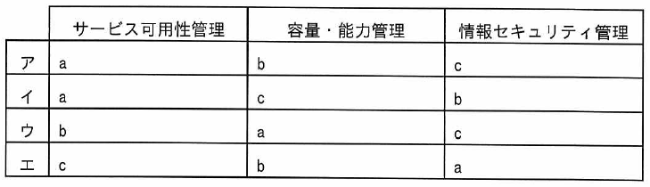

ITパスポート試験
## 令和5年度 問47 (マネジメント系)

あるホスティングサービスのSLAの内容にa～cがある。これらと関連するITサービスマネジメントの管理との適切な組合せはどれか。

<ol type="a">
  <li>サーバが稼働している時間</li>
  <li>ディスクの使用量が設定したしきい値に達したことを検出した後に、指定された担当者に通知するまでの時間</li>
  <li>不正アクセスの検知後に、指定された担当者に通知するまでの時間</li>
</ol>

***

<ol type="a">
  <li class="ans"><i>サーバが稼働している時間</i>：サービス可用性管理</li>
  <li class="ans"><i>ディスクの使用量が設定したしきい値に達したことを検出した後に、指定された担当者に通知するまでの時間</i>：容量・能力管理</li>
  <li class="ans"><i>不正アクセスの検知後に、指定された担当者に通知するまでの時間</i>：情報セキュリティ管理 </li>
</ol>

可用性とは、サービスやシステムを障害がなく正常に利用できることやその割合である。

p.284

[ H21s, H21f, H23f, H23, H24s, H24f, H25f, H26s, H27f, H28s, H30s, H31s, R3, R4, R5, R7 ]
