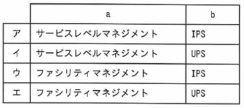

ITパスポート試験
## 令和5年度 問48 (マネジメント系)

システム環境整備に関する次の記述中の a、b に入れる字句の適切な組合せはどれか。
 
企業などがシステム環境である建物や設備などの資源を最善の状態に保つ考え方として [　a　] がある。その考え方を踏まえたシステム環境整備の施策として、突発的な停電が発生したときにサーバに一定時間電力を供給する機器である [　b　] の配備などがある。

***

企業などがシステム環境である建物や設備などの資源を最善の状態に保つ考え方として **ファシリティマネジメント** がある。その考え方を踏まえたシステム環境整備の施策として、突発的な停電が発生したときにサーバに一定時間電力を供給する機器である **UPS** （Uninterruptible Power Supply：無停電電源装置）の配備などがある。

p.297

[ H21f, H22s, H24f, H25s, H25f, H26f, H27s, H28s, H28f, H29s, H30s, H31s, R4, R5, R6, R8 ]

※IPS（Intrusion Prevention System）は侵入防止システムというネットワークセキュリティのための装置である。IDS（Intrusion Detection System：侵入検知システム）と併せて覚えると良い。

p.557

[ R5, R7 ]
