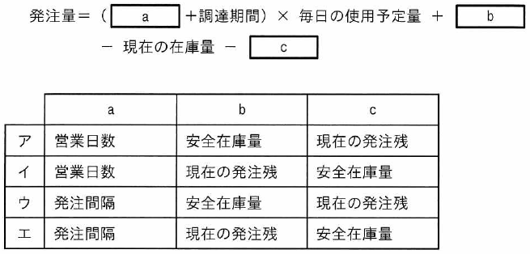

ITパスポート試験
## 令和6年度 問24 (ストラテジ系)

式は定期発注方式で原料の発注量を求める計算式である。a～cに入れる字句の適切な組合せはどれか。

  

***

<li class="ans">(発注間隔 + 調達期間) × 毎日の使用予定量 + 安全在庫量 - 現在の在庫量 - 現在の発注残</li>
 

定期発注方式：発注は毎週金曜日、毎月末など、決められた同じサイクルで行われる。

定量発注方式：最適な発注量は、発注費用と在庫維持費用の総額が最小となる場合である。
