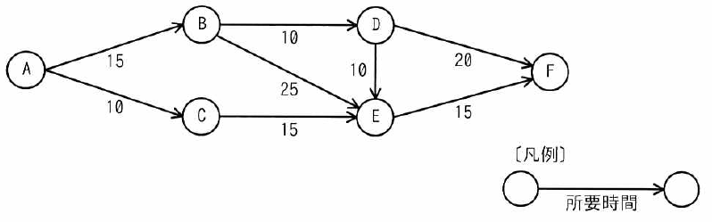

ITパスポート試験
## 令和6年度 問41 (マネジメント系)

あるプロジェクトの作業間の関係と所要時間がアローダイアグラムで示されている。このアローダイアグラムのBからEの四つの結合点のうち、工程全体の完了時間に影響を与えることなく、その結合点から始まる全ての作業の開始を最も遅らせることができるものはどれか。ここで、各結合点から始まる作業はその結合点に至る作業が全て完了するまで開始できず、作業から次の作業への段取り時間は考えないものとする。

<ol class="aiueo">
  <li>B</li>
  <li class="ans">C</li>
  <li>D</li>
  <li>E</li>
</ol>

***

作業の開始を遅らせることができるのは、クリティカルパス（最も時間がかかる遅れを許容できない経路）ではない経路である。 
よって、まずこの作業のクリティカルパスを求めると、 
ABDF = 15 + 10 + 20 = 45 
ABDEF = 15 + 10 + 10 + 15 = 50 
ABEF = 15 + 25 + 15 = 55 
ACEF = 10 + 15 + 15 = 40 
以上から、ABEFがクリティカルパスとなるので、正解はCまたはDに絞られる。

次に、CおよびDを通る経路について考える。 
Cを通る経路ACEFは40なので、クリティカルパスの55に対して、55 – 40 = 15遅らせることができる。同様に、Dを通る経路ABDFは45なので、クリティカルパスに対して10遅らせることができる。また、ABDEFは50なので、クリティカルパスに対して5遅らせることができる。 
以上から、作業の開始を最も遅らせることができるものは C となる。

p.267

[ H21s, H21f, H22s, H22f, H23f, H23, H24f, H25s, H26s, H27f, H28s, H30s, H30f, R1f, R2f, R3, R4, R5, R6, R7 ]
