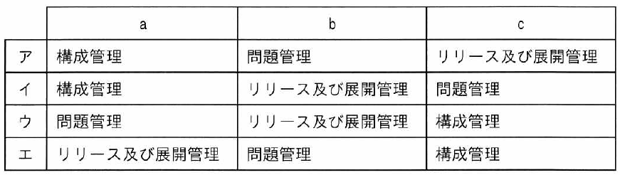

ITパスポート試験
## 令和6年度 問46 (マネジメント系)

ITサービスマネジメントの管理プロセスに関する記述a～cと用語の適切な組合せはどれか。

<ol type="a">
  <li>ITサービスの変更を実装するためのプロセス</li>
  <li>インシデントの根本原因を突き止めて解決策を提供するためのプロセス</li>
  <li>組織が所有しているIT資産を把握するためのプロセス</li>
</ol>

***

テストとは、ソフトウェア開発で実装後にシステムが仕様どおりに動作するかを確認する工程である。テスト内容やチェック項目に関しては、要件定義プロセスで決めておく。

<ol type="a">
  <li class="ans"><i>ITサービスの変更を実装するためのプロセス</i>：リリース及び展開管理</li>
  <li class="ans"><i>インシデントの根本原因を突き止めて解決策を提供するためのプロセス</i>：問題管理</li>
  <li class="ans"><i>組織が所有しているIT資産を把握するためのプロセス</i>：構成管理</li>
</ol>

p.238

[ H20f, H21f, H22s, H22f, H23f, H23, H24f, H25s, H25f, H26f, H28s, R4, R5, R8 ]
