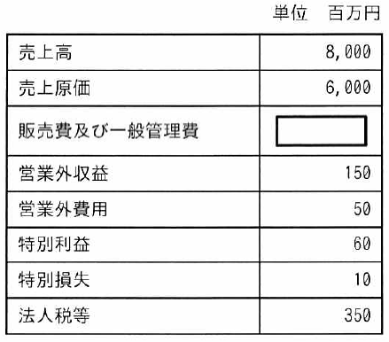

ITパスポート試験
## 令和6年度 問8 (ストラテジ系)

表はA社の期末の損益計算書から抜粋した資料である。当期純利益が800百万円であるとき、販売費及び一般管理費は何百万円か。
  

<ol class="aiueo">
  <li>850</li>
  <li>900</li>
  <li class="ans">1,000</li>
  <li>1,200</li>
</ol>

***

勘定科目のうち、どれが収入でどれが支出なのかを把握しておく。

総収入 
= 売上高 + 営業外収益 + 特別利益 
= 8000 + 150 + 60 
= 8210

総支出 
= 売上原価 + 販売費及び一般管理費 + 営業外費用 + 特別損失 + 法人税等 
= 6000 + x + 50 + 10 + 350 
= 6410 + x

純利益 = 総収入 – 総支出 
800 = 8210 – (6410 + x) 
x = 8210 – 6410 – 800 = 1000

よって、販売費及び一般管理費は1,000(百万円)

p.43

[ H21s, H21f, H22s, H22f, H23f, H24s, H25f, H26f, H28s, H30s, R3, R5, R6 ]

