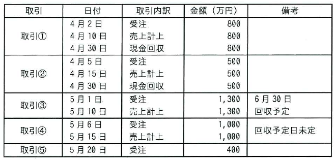

ITパスポート試験
## 令和7年度 問26 (ストラテジ系)

4月1日から5月31日までに、取引①から取引⑤があった。各取引の受注、売上計上、現金回収の状況が表のとおりであるとき、この取引先に対する5月31日時点の売掛金は何万円か。ここで、4月1日時点で売掛金残高はないものとする。
  

<ol class="aiueo">
  <li>1,000</li>
  <li>1,400</li>
  <li class="ans">2,300</li>
  <li>2,700</li>
</ol>

***

期間内で、売上計上しているが、満額を現金回収していない取引を探す。 
取引①と②は、５月３１日までに満額を回収しているので、売掛金には計上しない。 
取引③と④は売上計上しているが、５月３１日までに現金回収していないので、売掛金に計上する。 
取引⑤は売上計上していないので、売掛金には計上しない。 
よって、1300 + 1000 = 2300 (万円)

このような、特にどの分野に属するというわけでもないが、業務や会計に関係する計算問題が出題される。基本的には問題文をよく読み、常識に照らし合わせて解くことになるが、時間がかかりそうであれば後回しにする。
