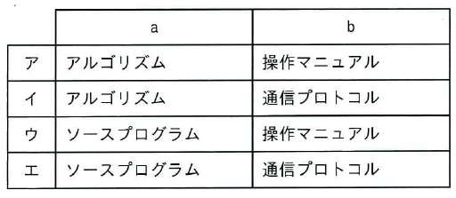

ITパスポート試験
## 令和7年度 問30 (ストラテジ系)

著作権に関して、次の記述中のa、bに入れる字句の適切な組合せはどれか。

[ a ] は著作権法による保護の対象になるが、[ b ] は対象にならない。

  

***

<u>ソースプログラムは著作権法による保護の対象になるが、通信プロトコルは対象にならない。</u>：アルゴリズムは一般化された計算や問題の解法、プロトコルはデータなどをやり取りするための規格化された取り決めなので、創作物には含まれない。

p.57

[ H21f, H22s, H23f, H23, H24s, H24f, H25s, H25f, H26s, H27f, H28s, H28f, H29f, H30s, H30f, H31s, R1f, R2f, R3, R4, R5, R7, R8 ]
