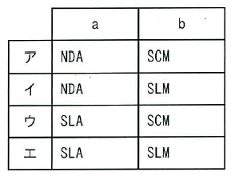

ITパスポート試験
## 令和7年度 問37 (マネジメント系)

ITサービスマネジメントに関して、次の記述中のa、bに入れる字句の適切な組合せはどれか。

[ a ] はサービス提供者と顧客との間で合意されたサービス品質に関する合意書である。 [ a ] の遵守状況を確認し、ITサービスの品質を維持・改善させるための活動が [ b ] である。
  

***

[ SLA ] はサービス提供者と顧客との間で合意されたサービス品質に関する合意書である。[ SLA ] の遵守状況を確認し、IT サービスの品質を維持・改善させるための活動が [ SLM ] である。

<ul>
    <li>NDA (Non Disclosure Agreement)：守秘義務契約
p.214

[ H27s, R4 ]
</li>
    <li>SCM (Supply Chain Management)：供給連鎖管理
p.119

[ H25f, H27f, R2f, R3, R4, R8 ]
</li>
    <li class="ans">SLM (Service Level Management)：サービスレベル管理
p.283

[ H24f, H26f, H27s, H28s, R3, R7, R8 ]
</li>
    <li class="ans">SLA (Service Level Agreement)：サービスレベル合意書
p.284

[ H21s, H21f, H23f, H23, H24s, H24f, H25f, H26s, H27f, H28s, H30s, H31s, R3, R4, R5, R7, R8 ]
</li>
</ul>

※SL～から始まる語は、SLA, SLM, SLI, SLOなどService Level～を表すことが多いが、SLCPはソフトウェアライフサイクルプロセス なので注意

p.204

[ H21f, H22s, H23f, H23e, H25s, H26s, H28s, H29f, R3, R7 ]

