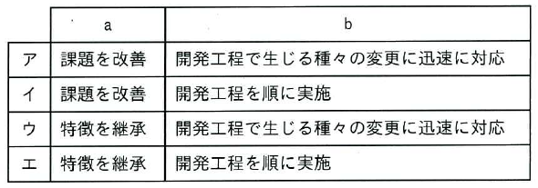

ITパスポート試験
## 令和7年度 問39 (マネジメント系)

ソフトウェア開発モデルであるアジャイルモデルの特徴に関して、次の記述中のa、bに入れる字句の適切な組合せはどれか。

アジャイルモデルとは、要件を確定してから開発を実施するウォーターフォールモデルの [ a ] する形で提唱された、 [ b ] できるようにソフトウェアを開発するための手法の総称である。
  

***
アジャイルモデルとは、要件を確定してから開発を実施するウォーターフォールモデルの [ 課題を改善 ] する形で提唱された、 [ 開発工程で生じる種々の変更に迅速に対応 ] できるようにソフトウェアを開発するための手法の総称である。

アジャイルは、開発する機能を小さい単位に分割し、優先度の高いものから短期間（スプリント）に開発とリリースを繰り返す手法。比較的小規模な開発に用いられる。XP（エクストリームプログラミング）もアジャイル開発の一種。

p.246

[ H31s, R1f, R2f, R3, R6, R7, R8 ]

ウォーターフォールは、開発プロセスを上流工程から下流工程へ向かって一直線に進める手法。大規模な開発に用いられる。

p.245/div>

[ H21s, H25f, H27s, H27f, H28f, H30s, R8 ]

