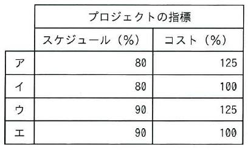

ITパスポート試験
## 令和7年度 問45 (マネジメント系)

計画時の予算が2,000万円で、40日間で100本のプログラムを作成するプロジェクトがある。プロジェクトが20日経過した時点で全体の40%である40本のプログラムが完成し、1,000万円のコストが掛かった。プロジェクトの指標を次の評価式で算出する場合、プロジェクトの指標として適切な組合せはどれか。ここで、各プログラムの作成に必要な日数及びコストは全て同一で、プロジェクト期間中は常に同じ量の作業が実施されるものとする。

〔評価式〕 
スケジュール(%)： 
(完成したプログラム本数 ÷ 評価時点での完成見込みプログラム本数) × 100 
コスト(%)： 
(完成したプログラムに掛かったコスト ÷ 完成したプログラム分として計画したコスト) × 100
  

***

スケジュール(%)： 
完成したプログラム本数とは、20日経過した現時点で完成している本数 
評価時点での完成見込みプログラム本数とは、現時点で本来完成しているべき本数 
(完成したプログラム本数 ÷ 評価時点での完成見込みプログラム本数) × 100 
= (40本 ÷ (100本 × 20日 ÷ 40日) × 100 
= (40本 ÷ 50本) × 100 
= 80％

コスト(%)： 
完成したプログラムに掛かったコストとは、20日経過した現時点で掛かっているコスト 
完成したプログラム分として計画したコストとは、計画していた予算のうち現時点で完成している本数の分 
(完成したプログラムに掛かったコスト ÷ 完成したプログラム分として計画したコスト) × 100
= (1000万円 ÷ (2000万円 × 40％)) × 100 
= (1000万円 ÷ 800万円) × 100 
= 125％