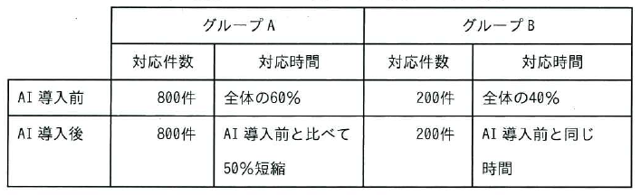

ITパスポート試験
## 令和7年度 問54 (マネジメント系)

あるコールセンターでは、顧客からの電話による問合せに対応するオペレーターを支援するシステムに、顧客とオペレーターの会話の音声を認識し、顧客の問合せに対する回答の候補をオペレーターのPCの画面に表示するAIを導入した。1日の対応件数は1,000件であり、問合せ内容によって二つのグループ A、Bに分けた。AI導入前後の各グループの対応件数、対応時間が表のとおりであるとき、AI導入後に、1,000件の問合せに対応する時間は何%短縮できたか。
  

<ol class="aiueo">
  <li class="ans">30</li>
  <li>40</li>
  <li>50</li>
  <li>60</li>
</ol>

***

AI導入前の全体の対応時間をTとすると、 
AI導入後は、グループAがTの60%を50%短縮しているので、0.6T × 0.5 = 0.3T、 
グループBは0.4T で変わらないので、グループA、Bあわせて 0.7T に短縮されたことになる。 
よって、30%
