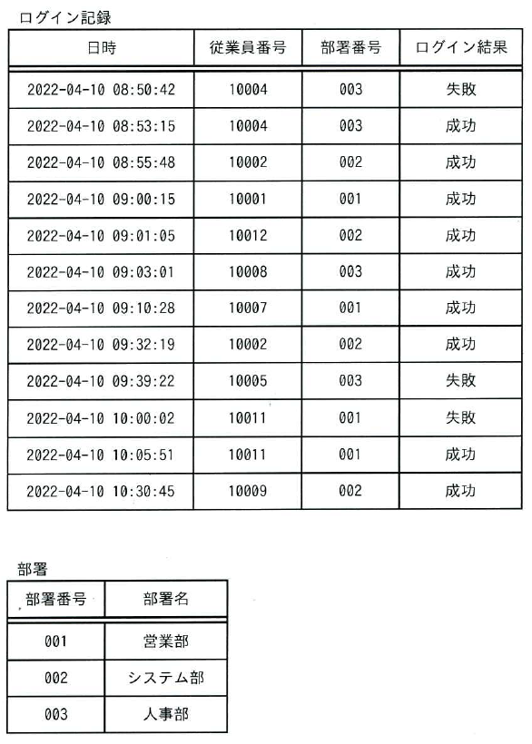

ITパスポート試験
## 令和7年度 問66 (テクノロジ系)

関係データベースで管理している次の"ログイン記録"表及び"部署"表において、ログイン結果が失敗となったことのある、又は、2022年4月10日09:00:00以前にログイン結果が成功となったことのある従業員が所属する部署名だけを全て挙げたものはどれか。
  

<ol class="aiueo">
  <li>営業部、システム部</li>
  <li class="ans">営業部、システム部、人事部</li>
  <li>営業部、人事部</li>
  <li>システム部、人事部</li>
</ol>

***

まず、ログイン記録表を見ると、 
条件1：全期間でログイン結果が失敗となったもの = 001, 003 
条件2：2022年4月10日09:00:00以前にログイン結果が成功となったもの = 002, 003 
これらの条件が「又は、」で接続されているので、どちらか一方の条件に合うものであれば全て該当する。

次に、部署表を見て、該当する部署番号に対応する部署名を確認する。

よって、**営業部、システム部、人事部**の全ての部署が該当する。

※「かつ、」で接続されていた場合は、003（人事部）だけが該当する。

p.459

[ H21s - R8 ]

