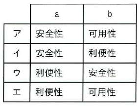

ITパスポート試験
## 令和7年度 問69 (テクノロジ系)

バイオメトリクス認証の他人受入率と本人拒否率に関する次の記述中のa、bに入れる字句の適切な組合せはどれか。

バイオメトリクス認証の認証精度において、他人受入率を低く抑えようとすると [ a ] が高くなり、本人拒否率を低く抑えようとすると [ b ] が高くなる。
  

***

バイオメトリクス認証の認証精度において、他人受入率を低く抑えようとすると**安全性**が高くなり、本人拒否率を低く抑えようとすると**利便性**が高くなる。

　バイオメトリクス認証は、指紋や虹彩、遺伝子、筆跡や個人の動きの癖といった複雑な情報によって本人確認を行うため、パスワード認証のように認証情報が合致するかしないかを一意に区別できるものではなく、どの程度の一致率で本人と認めるかを調整する必要がある。そのための指標として他人受入率と本人拒否率があり、これらはトレードオフな関係にある。

他人受入率（False Acceptance Rate：FAR）：本当は他人なのに認証に成功してしまう割合であり、高すぎると本人以外でも簡単に認証されてしまい、低すぎると体調や経年変化で身体の状態が変わった際に本人なのに認証できなくなる。

本人拒否率（False Rejection Rate：FRR）：本当は本人なのに認証に失敗してしまう割合であり、高すぎると体調や経年変化で身体の状態が変わった際に本人なのに認証できなくなり、低すぎると本人以外でも簡単に認証されてしまう。

※可用性とは、サービスやシステムを障害がなく正常に利用できることやその割合である。バイオメトリクスの認証システムにおける可用性も、システムが故障や障害で利用できなくなる場合の指標である。本人拒否率の設定における認証の可・不可は、システムの正常な動作であるので可用性とは関係ない。

p.506

[ H21s, H23, H25f, H26f, H27f, H28s, H29s, H29f, H30s, H30f, H31s, R1f, R2f, R3, R4, R5, R6, R7, R8 ]

