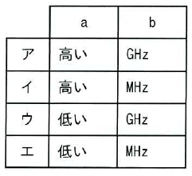

ITパスポート試験
## 令和7年度 問71 (テクノロジ系)

携帯電話で用いられる電波に関する次の記述中のa、bに入れる字句の適切な組合せはどれか。

電波には、周波数が [ a ] ほど回り込みやすくなり障害物の裏にも届きやすいという性質がある。日本国内の携帯電話で使用される周波数のうち、700 [ b ] 帯～900 [ b ] 帯の周波数帯域はこの性質をもちつながりやすいことなどから、プラチナバンドと呼ばれている。
  

***

電波には、周波数が **低い** ほど回り込みやすくなり障害物の裏にも届きやすいという性質がある。日本国内の携帯電話で使用される周波数のうち、700 **MHz** 帯～900 **MHz** 帯の周波数帯域はこの性質をもちつながりやすいことなどから、プラチナバンドと呼ばれている。

　電波は振幅運動によって移動（伝搬）し、周波数はその振幅の細かさ（1秒間の振幅の回数）、波長は1つの振幅の長さを表す。
よって、周波数が高いほど波長は短くなり、周波数が低いほど波長は長くなる（速度は一定とした場合）。
また、電波は周波数が高くなる（波長が短くなる）と直進性が増し、指向性が高くなる（特定の方向へ届きやすい）。

　障害物について考える場合、
波長が長い（周波数が低い）ほど障害物に対して相対的に大きな波となるため、障害物を回り込みやすくなる（回折）。
直進性について考えれば、周波数が低いほど直進性が低いので、障害物の周りに広がって回り込みやすくなるとも言える。
また、遮蔽物によって電波が弱まる性質（遮蔽）や遮蔽物を通り抜ける性質（透過）にも周波数による特性がある。

　それぞれの電波がどれほどの周波数帯なのかは、電磁波の一覧などを見て覚えると良い。およそ3T(3000G)Hzを超えるものは光の領域になり、それ以下のものが電波に分類される。ただし、前述の通り、周波数が高い電波は障害物の影響を受けやすく伝搬損失が大きくなるため、携帯電話などのデータ通信には利用されていない。問題にある700～900という周波数がGHｚのオーダーだった場合は、サブミリ波という非常に高周波数帯の電波となり、データ通信ではなく天文の電波望遠鏡やセンサーに利用されている。

[周波数帯ごとの主な用途と電波の特徴（総務省）](https://www.tele.soumu.go.jp/j/adm/freq/search/myuse/summary/)

[ H30f, R7 ]

