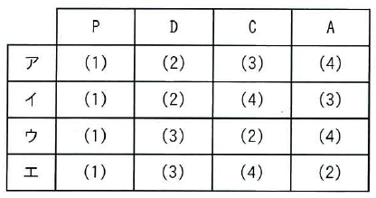

ITパスポート試験
## 令和7年度 問83 (テクノロジ系)

ISMSの運用にPDCAモデルを採用している組織において、サーバ監視に関する次の作業を実施する。各作業とPDCAモデルの各フェーズの組合せとして、適切なものはどれか。

〔作業〕
<ol>
    <li>サーバ監視の具体的な目的及び手順を定める。</li>
    <li>サーバ監視の作業内容を第三者が客観的に評価する。</li>
    <li>定められている手順に従ってサーバを監視する。</li>
    <li>発見された問題点の是正処置として、サーバの監視方法を変更する。</li>
</ol>

  

***

PDCAサイクルは、Plan（計画）、Do（実行）、Check（評価）、Act（改善）からなる業務の運用方法である。SLM（サービスレベル管理）やISMS（情報セキュリティマネジメントシステム）と併せてよく出題される。

<ol>
    <li><i>サーバ監視の具体的な目的及び手順を定める。</i>：Planに該当する。</li>
    <li><i>サーバ監視の作業内容を第三者が客観的に評価する。</i>：Checkに該当する。</li>
    <li><i>定められている手順に従ってサーバを監視する。</i>：Doに該当する。</li>
    <li><i>発見された問題点の是正処置として、サーバの監視方法を変更する。</i>：Actに該当する。</li>
</ol>

| P | D | C | A |
| :---: | :---: | :---- | :---: | :---: |
| **(1)** | **(3)** | **(2)** | **(4)** |

ISMS

p.534

[ H22s, H22f, H23, H24s, H25f, H26f, H27s, H27f, H29f, H30s, H30f, H31s, R1f, R2f, R3, R4, R5, R6, R7, R8 ]

PDCA

p.283

[ H22s, H22f, H23, H24s, H25f, H26f, H27s, H27f, H29f, H30s, H30f, H31s, R1f, R2f, R3, R5, R6, R7, R8 ]

