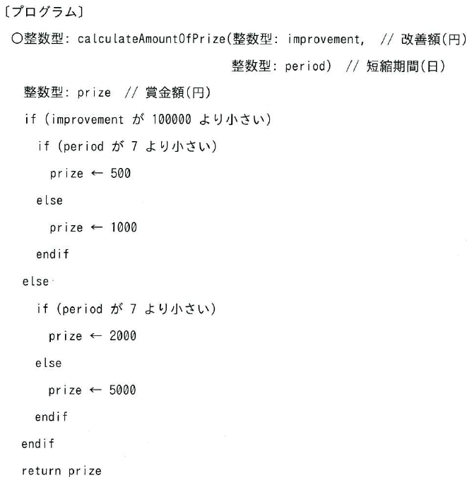

ITパスポート試験
## 令和7年度 問99 (テクノロジ系)

関数 calculateAmountOfPrize は、業務改善の効果における改善額と短縮期間を、それぞれ improvement と period で受け取り、賞金額を戻り値とする。改善額が20万円で短縮期間が3日の業務改善と、改善額が5万円で短縮期間が14日の業務改善があった。この二つの賞金額の合計は何円か。ここで、改善額と短縮期間の値はそれぞれ0以上とする。
  

<ol class="aiueo">
  <li>1,000</li>
  <li>1,500</li>
  <li class="ans">3,000</li>
  <li>5,500</li>
</ol>

***

改善額が20万円で短縮期間が3日の業務改善では、calculateAmountOfPrize(200000, 3)なので2,000が返る 
改善額が5万円で短縮期間が14日の業務改善では、calculateAmountOfPrize(50000, 14)なので1,000が返る 
よって、合計で**3,000**円

このような疑似プログラミング言語に関する問題は毎年数問出題される。
