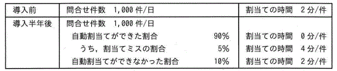

ITパスポート試験
## 令和8年度 問44 (マネジメント系)

あるサービスデスクでは、電子メールによる問合せに対応しており、受付担当者がメールの内容を確認し、回答担当者の割当てをしていた。このたび、割当て業務の効率化を目的に、自動割当てツールを導入した。自動割当てツールは、メールの内容を基に自動で回答担当者の割当てを行うが、割当てができないことや割当てミスをすることがあり、それらについては、人手で対応している。導入前及び導入半年後の状況が次のとき、割当ての時間はサービスデスク全体で何%削減できたか。ここで、割当ての時間の削減率(%)は小数第1位を四捨五入するものとする。
  

<ol class="aiueo">
  <li>80</li>
  <li class="ans">81</li>
  <li>85</li>
  <li>86</li>
</ol>

***

ツール導入前と導入後の時間を比較する。

導入前は、1000件 ✕ 2分 = 2000分 
導入後は、問合せ数は同じく1000件だが、割当て成功では時間が0分で、失敗では時間を要する。 
(1000件 ✕ 90％ ✕ 0分) + (1000件 ✕ 90％ ✕ 5％ ✕ 4分) + (1000件 ✕ 10％ ✕ 2分) 
= 0分 + (45件 ✕ 4分) + (100件 ✕ 2分) 
= 380分

削減できた時間は、2000分 - 380分 = 1620分 
よって、1620 ÷ 2000 ✕ 100 = 81％
