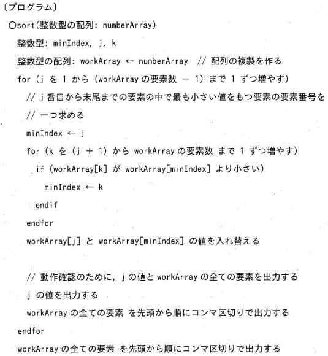

ITパスポート試験
## 令和8年度 問67 (テクノロジ系)

手続 sort は、要素数が2以上の整数型の配列を引数 numberArray で受け取り、その要素を昇順に並べ替えた結果を出力する。手続 sort の動作確認のために、処理の途中でjの値と workArray の全ての要素を出力する。配列 numberArray を{3, 5, 1, 2, 4}とし、手続 sort を sort(numberArray) として呼び出したとき、jの値が3と出力された直後の workArray の全ての要素の出力はどれか。ここで、配列の要素番号は1から始まる。
  

<ol class="aiueo">
  <li>1,2,3,4,5</li>
  <li class="ans">1,2,3,5,4</li>
  <li>4,5,3,2,1</li>
  <li>5,4,3,2,1</li>
</ol>

***

{3, 5, 1, 2, 4}という配列を昇順に並べ替えるプログラムである。
手続きsortという名前のアルゴリズムは存在しないが、プログラムの処理手順は選択ソートを行っている。
つまり、配列から最小値を調べ、次にその最小値を除いた配列から新たに最小値を求める、ということを繰り返していく。
よって、配列が並べ替えられる様子は下記のようになる。

| j | numberArray{} |
| :-----: | :-----: | :-----: | :-----: | :-----: | :-----: |
|   | {3, 5, 1, 2, 4} |
| 1 | {**1,** 3, 5, 2, 4} |
| 2 | {**1, 2,** 3, 5, 4} |
| 3 | {**1, 2, 3,** 5, 4} |
| 4 | {**1, 2, 3, 4,** 5} |
| 5 | {**1, 2, 3, 4,** 5} |
