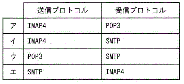

ITパスポート試験
## 令和8年度 問68 (テクノロジ系)

メールソフトが電子メールの送受信に用いるプロトコルの組合せとして、適切なものはどれか。
  

***

プロトコルで出題されやすいのはメールに関するもの。

SMTP（Simple Mail Transfer Protocol）：送信プロトコル p.493 [ R8 ]

POP3（Post Office Protocol version 3）：受信プロトコル p.494 [ R3 ]

IMAP4（Internet Message Access Protocol version 4）：受信プロトコル p.494 [ R4, R8 ]

その他、
TCP/IP [ R5 ]、FTP、HTTP（HTTPS)など。