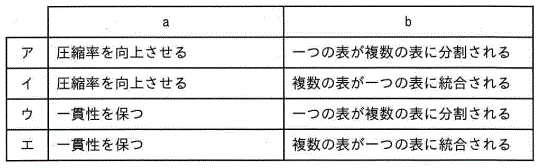

ITパスポート試験
## 令和8年度 問69 (テクノロジ系)

関係データベースにおけるデータの正規化に関する次の記述中のa、bに入れる字句の適切な組合せはどれか。

正規化の主な目的として、データの重複を排除し、[ a ] ことが挙げられる。正規化には複数の段階があり、これを進めていくと、[ b ] 。  

***

正規化の主な目的として、データの重複を排除し、 **一貫性を保つ** ことが挙げられる。正規化には複数の段階があり、これを進めていくと、 **一つの票が複数の表に分割される** 。

p.465

[ H21f, H22f, H24s, H26s, H26f, H28f, H29s, H29f, H30s, H31s, R1f, R5, R6, R8 ]
