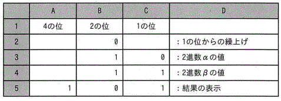

ITパスポート試験
## 令和8年度 問74 (テクノロジ系)

表計算ソフトを用いて、二つの2進数α、βの和を求める。α、βの桁数は2桁に限定し、2の位、1の位の順に各桁の値がセルB3、セルC3とセルB4、セルC4に入力されている。ワークシートは2進数α＝10、β＝11の例である。結果は、4の位、2の位、1の位の順にセルA5、セルB5、セルC5に表示したい。セルB2は1の位からの繰り上がりの情報を格納するために用いられ、式 IF(C3＋C4＝2，1，0) が入力されている。セルB5に入力する式はどれか。
  

<ol class="aiueo">
  <li class="ans">IF(合計(B2:B4)＜2，合計(B2:B4)，IF(合計(B2:B4)＝2，0，1))</li>
  <li>IF(合計(B2:B4)＜2，合計(B2:B4)，IF(合計(B2:B4)＝2，1，0))</li>
  <li>IF(合計(B2:B4)＞2，合計(B2:B4)，IF(合計(B2:B4)＝2，0，1))</li>
  <li>IF(合計(B2:B4)＞2，合計(B2:B4)，IF(合計(B2:B4)＝2，1，0))</li>
</ol>

***

2の位の合計は、(1 + 1 + 1)2、(1 + 1 + 0)2、(1 + 0 + 0)2の３つの組み合わせがある（２進数、順不同）。 
このうち桁上りしないのは(1 + 0 + 0)2のみなので、この場合はそのまま算出すれば良い。これはつまり、合計が２未満の場合である。 
(1 + 1 + 1)2、(1 + 1 + 0)2は桁上りが起き、それぞれ2進数で(11)2、(10)2となるが、表計算は10進で行われるので、セルB5には合計が3なら1、2なら0を入力する（つまり、合計が2なら0、それ以外なら1を入力する）。 
※本来はセルA5にも1を入力する必要があるが、これを加味した式は選択肢にないので考えなくて良い。

<pre>
if(合計 < 2) {
    合計を入力
} else {
    if(合計 == 2) 0を入力
    else 1を入力
}
</pre>

<ol class="aiueo">
  <li class="ans"><i>IF(合計(B2:B4)＜2，合計(B2:B4)，IF(合計(B2:B4)＝2，0，1))</i>：正解</li>
  <li><i>IF(合計(B2:B4)＜2，合計(B2:B4)，IF(合計(B2:B4)＝2，1，0))</i></li>
  <li><i>IF(合計(B2:B4)＞2，合計(B2:B4)，IF(合計(B2:B4)＝2，0，1))</i></li>
  <li><i>IF(合計(B2:B4)＞2，合計(B2:B4)，IF(合計(B2:B4)＝2，1，0))</i></li>
</ol>
