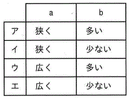

ITパスポート試験
## 令和8年度 問76 (テクノロジ系)

IoTデバイスで用いられるLPWAに関する次の記述中のa、bに入れる字句の適切な組合せはどれか。

LPWAに分類される無線通信方式の特徴は、通信可能な範囲が無線LANに比べて [ a ]、消費する電力が第4世代移動通信規格(4G)に比べて [ b ]。

***

LPWAに分類される無線通信方式の特徴は、通信可能な範囲が無線LANに比べて **広く**、消費する電力が第4世代移動通信規格(4G)に比べて **少ない**。

LPWAはLow Power Wide Areaの略であり、その名の通り消費電力が少なく（WiFiの10分の1から数百分の1）、通信範囲が広い（Wifiの100倍ほど）。一方で、1回の通信データ量は非常に小さく（10～100バイト程度）、通信間隔にも制限がある（1分毎や数時間毎など）。遠隔地のセンサデバイスとの通信などに使用される。

同様に消費電力が小さいIoT向けの通信方式として、BLE（Bluetooth Low Energy）があり、こちらは近距離での省電力通信に向いている。

| 通信方式 | 通信距離 | 通信速度 | 送信電力 | 待機電力 | 特徴 | 主な用途 |
| :-----: | :-----: | :-----: | :-----: | :-----: | :-----: |
| WiFi      | 100m     | 1,000 Mbps | 150 mA   | 100 mA  | 屋内用途でバランスが良く幅広い機器に対応する            | 屋内の中規模装置（PCなど） |
| Bluetooth | 10m      | 3 Mbps     | 50 mA    | 10 mA   | 消費電力が少なく通信性能も低いので近距離の小型機器に向く | 屋内の小規模装置（PC周辺機器など） |
| BLE       | 100m     | 2 Mbps     | 10 mA    | 0.01 mA | Bluetoothよりやや広い範囲の小型機器に向く              | 屋内の小規模装置（室内センサ機器など） |
| LPWA      | 10,000m  | 0.001 Mbps | 100 mA   | 0.01 mA | 通信速度は非常に小さいが、通信距離と消費電力に優れる     | 屋外・遠隔地の小規模装置（屋外センサ機器など） |
| LTE(4G)   | 1,000m   | 1,000 Mbps | 500 mA   | 10 mA   | ある程度の電力が確保できる移動体通信に向く              | 屋外の小規模装置（モバイル端末など） |
| LTE(5G)   | 500m     | 5,000 Mbps | 1,000 mA | 50 mA   | 高速・大容量を必要とする移動体通信に向く                | 屋外の中規模装置（モバイル端末や車両、ロボット） |

※数値はおおよその値

p.510

[ H31s, R1f, R2, R3, R8 ]

