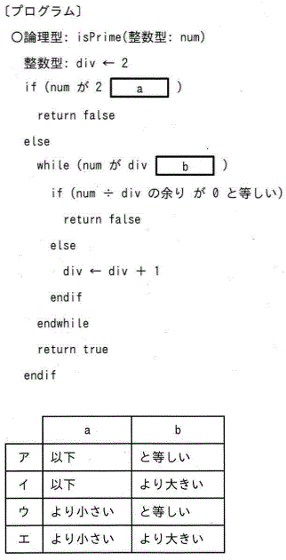

ITパスポート試験
## 令和8年度 問85 (テクノロジ系)

関数 isPrime は、引数として与えられた正の整数が、素数であればtrueを、素数でなければfalseを戻り値とする。例えば、関数 isPrime を isPrime(2) として呼び出したときの戻り値はtrueである。プログラム中のa、bに入れる字句の適切な組合せはどれか。
  

***

引数num（判定対象の整数）を2からその数未満までで割っていき、途中で割り切れてしまったら素数ではなく（false）、どれでも割り切れなければ素数（true）と判定する。 
ただし、この条件だけでは0と1が引数の場合も素数と判定されてしまうので、はじめのif文で2未満の引数は素数ではない（false）としている基本的な素数判定のプログラムである。

よって、 
if (numが2**より小さい**) が真となるnumが0または1の場合ははじめに素数ではないと判定しておき、それ以外の引数は 
while (numがdiv**より大きい**) という継続条件で順に割り切れるか調べていく。 
divは1ずつ増加していき、num = divとなった時点でwhileループを終了するので、その時点では（1と）num自身でのみ割り切れるもの（つまり素数）がtrueと返される。

このような疑似プログラミング言語に関する問題は毎年数問出題される。
