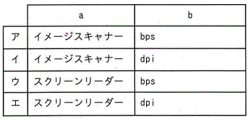

ITパスポート試験
## 令和8年度 問99 (テクノロジ系)

入力装置に関する次の記述中のa、bに入れる字句の適切な組合せはどれか。

[ a ] は、紙などに光を当て、反射光を読み取り、文字や図形をデジタルデータに変換してPCに取り込む。 [ a ] が文字や図形をどの程度細かく読み取れるかの性能を示す単位として [ b ] が使われる。
  

***

**イメージスキャナー** は、紙などに光を当て、反射光を読み取り、文字や図形をデジタルデータに変換してPCに取り込む。 **イメージスキャナー** が文字や図形をどの程度細かく読み取れるかの性能を示す単位として **dpi** が使われる。

イメージスキャナーは問題文の通りハードウェアである。一方、スクリーンリーダーは画面の表示された文字情報を読み取るソフトウェアであり、読み取った情報は音声や点字ディスプレイとして出力される。

dpi(dot per inch)は１インチあたりのドット数を表す単位で、精細さの指標となる。コンピュータグラフィックスでは、表示するものは点（画素）の集合であることから、イメージスキャナーのような入力装置の場合にはどれくらい細かく対象を読み取るかを表し、プリンターやディスプレイのような出力装置の場合は解像度を表す。

また、イメージスキャナーの光学的に文字を読み取る仕組みをOCR（Optical Character Recognition）と呼ぶ。マークシートなどの単純な印を読み取るOMR（Optical Mark Recognition/Reader）という装置も存在する。

p.409

[ H27f, R6, R7, R8 ]

